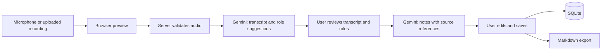

# ConsultNote product and technical design

Date: 2026-10-13

Status: Approved baseline; Milestone 1 implemented

Project: `C:\Personal\Repositories\consultnote`

## 1. Intent and success

Build a professional web application that demonstrates an audio-to-notes workflow in an interview. A user records or uploads a doctor-patient conversation, reviews a speaker-labeled transcript and suggested roles, generates grounded notes, and edits or saves the result.

The user confirmed microphone recording, uploaded recordings, speaker distinction, doctor/patient identification, notes covering all communication, Gemini first, and Git version control. The approved implementation currently covers Milestone 1: the application shell and validated domain contracts. Audio capture, AI processing, and persistence remain planned milestones.

Working defaults are a single user running the application locally, desktop Chrome/Edge for recording, responsive review screens, and English evaluation samples. These are scope choices rather than user-supplied requirements. Mixed-language quality is unverified.

Success means completing the workflow with new audio, reopening saved notes after a restart, explaining the architecture, and showing measured strengths and limitations on fictional sample conversations.

## 2. First-release scope

- Microphone recording with start, stop, elapsed time, and a visible input-level indicator.
- Upload MP3, WAV, WebM, or OGG audio; playback before processing.
- Speaker-labeled transcript with approximate timestamps and editable text.
- Suggested `doctor`, `patient`, or `unknown` roles, with a short reason and user correction.
- A separate note-generation action after transcript/role review.
- Editable notes covering relevant medical and nonmedical topics actually discussed, decisions, and next steps.
- Source links from note items to transcript segments.
- Save, list, reopen, rename, update, and delete consultations; Markdown export.
- Clear empty, recording, processing, review, saved, and failure states.

Live transcription, calling/video, electronic health record integration, diagnosis generation, billing, model training, local AI, authentication, and public multi-user hosting are outside the first release. The application initially binds to localhost for the interview demonstration.

## 3. Architecture and stack

Use one Next.js App Router application with strict TypeScript and Tailwind CSS. Route handlers run in the Node runtime. Browser APIs handle capture and playback. Server-only modules handle input validation, Gemini calls, and SQLite persistence. Avoid an ORM, a separate API service, a queue, and a provider abstraction in this release.

Use Node.js 24 LTS, npm, the official `@google/genai` SDK, Zod, Node's built-in `node:sqlite`, and an installed `ffprobe` executable. Resolve compatible stable application dependencies when scaffolding and commit `package-lock.json`. The current machine has Node 24 and working built-in SQLite; `ffprobe` availability remains an implementation prerequisite.

## 4. Audio handling

Use `getUserMedia({ audio: true })` and `MediaRecorder`. Select supported WebM/Opus, then OGG/Opus with `MediaRecorder.isTypeSupported`. If neither is available, keep upload usable and explain that microphone recording is unsupported. Stop microphone tracks and release playback object URLs when replacing/resetting input or leaving the capture screen.

The file limit is **10 MiB (10,485,760 bytes)** and duration limit is **10 minutes (600 seconds)**. Stop browser recording at 600 seconds. Check limits in the UI and independently on the server. Bound the entire multipart request to **11 MiB (11,534,336 bytes)** before parsing, then enforce the 10 MiB file limit.

Inspect file signatures with `file-type`, normalize supported MIME aliases, and inspect the audio with `ffprobe` through `execFile`, without a shell. Permit MP3 (`audio/mpeg`), WAV (`audio/wav`), WebM (`audio/webm`), and OGG (`audio/ogg`). Verify an audio stream exists and obtain duration; use final audio-packet timing when a browser WebM lacks container duration. Reject unreadable audio or duration that cannot be determined. Limit inspection to 15 seconds and remove temporary files in `finally`.

Send accepted audio inline as base64 to Gemini; 10 MiB remains below Google's 20 MB inline request threshold after base64 expansion and ordinary metadata. Do not use the provider Files API in this release. Audio remains in browser memory for the current preview; the server retains only a temporary inspection file. Provider-side data handling follows Google's terms and is separate from application cleanup.

## 5. Gemini processing

Initial model: **`gemini-3.8-flash`**, configured by `GEMINI_MODEL`. Google currently lists free-tier usage for this model and documents audio understanding and structured output. Confirm access and schema compatibility with a short live fictional sample before building the complete workflow. If account access fails, report it; do not silently change model or enable billing.

Use `@google/genai` in `src/lib/gemini.ts` with the configured server-side key. Keep the SDK endpoint choice private to this module and follow the current documented audio/structured-output API. Request JSON matching the domain schemas, validate with Zod, then validate cross-references. Disable automatic continuation and application-level automatic retries; each user action initiates one bounded generation request.

**Stage 1:** Send the audio and transcription instructions. Return spoken text, stable speaker IDs, chronological segments, approximate timestamps, and role suggestions based on conversational evidence. Set `durationSeconds` on the server from the validated audio rather than a model estimate. Preserve ambiguity as `unknown`, including additional speakers. Require complete coverage rather than a summary. Audio content is untrusted input; spoken instructions cannot change the extraction task.

**Stage 2:** Send the reviewed transcript and user-selected role assignments as data. Generate discussion notes, explanations, decisions, follow-up actions, and other relevant context. Include sections only when supported. Every note item cites one or more segment IDs. Missing information stays absent and uncertainty remains explicit. References aid review; they do not prove a note is factually correct.

Use a deadline of **120 seconds per generation request**, with output budgets of **16,384 tokens for transcription** and **8,192 tokens for notes**. Treat empty, blocked, truncated, invalid, or non-complete responses as failures. Return actionable messages for missing configuration, authentication, unavailable model, quota, network, and timeout failures. Preserve the current audio/transcript for manual retry. Test actual model compatibility and output budgets in the live evaluation.

## 6. Domain contracts

Types live in `src/lib/consultation.ts`; derive TypeScript types and provider JSON schemas from Zod definitions.

| Type | Fields and rules |
| --- | --- |
| `SpeakerRole` | `doctor`, `patient`, or `unknown` |
| `Speaker` | `id`, `suggestedRole`, `reason`; role suggestion remains separate from user assignment |
| `Segment` | `id`, `speakerId`, `startSeconds`, `endSeconds`, `text`; nonempty text, nonnegative ordered timestamps |
| `Transcript` | `durationSeconds`, `speakers`, `segments`; unique IDs, valid speaker references, chronological starts, end at most duration + 1 second |
| `SpeakerAssignment` | `speakerId`, `role`; exactly one assignment per known speaker ID |
| `NoteItem` | `text`, nonempty `segmentIds`; every reference resolves to the transcript |
| `NoteSection` | `kind`, `items`; kind is `discussion`, `explanations`, `decisions`, `followUp`, or `context`; no duplicate kinds or empty sections |
| `Notes` | `sections`; a successful result contains at least one supported note item |
| `NotesResult` | `notes`, `sourceDigest`; SHA-256 of the reviewed transcript and assignments |
| `ConsultationInput` | `title`, `transcript`, `assignments`, `notesResult`, `model`, `promptVersion`; title is 1-120 trimmed characters |
| `ConsultationRecord` | `ConsultationInput` plus UUID `id`, server-generated UTC `createdAt` and `updatedAt` |
| `ConsultationSummary` | `id`, `title`, `createdAt`, `updatedAt` |

Compute `sourceDigest` with Node's `createHash` over `JSON.stringify({ transcript, assignments })`, with assignments sorted by speaker ID. A transcript or role edit invalidates existing notes. Confirm before discarding edited notes, regenerate against the revised input, and reject stale notes at save time. Notes can be edited while preserving valid source references.

## 7. HTTP and storage contracts

| Route | Request | Successful response |
| --- | --- | --- |
| `POST /api/transcribe` | Multipart field `audio` | `{ transcript, model, promptVersion }` |
| `POST /api/notes` | JSON `{ transcript, assignments }` | `NotesResult` |
| `GET /api/consultations` | None | `{ consultations: ConsultationSummary[] }`, newest update first |
| `POST /api/consultations` | `ConsultationInput` | `201`, `ConsultationRecord` |
| `GET /api/consultations/:id` | UUID path | `ConsultationRecord` |
| `PATCH /api/consultations/:id` | Complete `ConsultationInput` replacement | `ConsultationRecord`; preserve ID and creation time |
| `DELETE /api/consultations/:id` | UUID path | `204` |

Errors use `{ error: { code, message } }`: `INVALID_INPUT` (400), `NOT_FOUND` (404), `AUDIO_TOO_LARGE` (413), `UNSUPPORTED_AUDIO` (415), `NO_SPEECH` (422), `INVALID_AI_OUTPUT` (502), `AI_AUTH_FAILED` (502), `AI_UNAVAILABLE` (503), `AI_QUOTA_EXCEEDED` (429), `AI_TIMEOUT` (504), `STORAGE_FAILED` (500), and `INTERNAL_ERROR` (500) for unexpected failures. Browser-permission failures stay client-side. Hide raw provider responses, credentials, and private payloads from errors/logs. Bound JSON request bodies to 1 MiB and reject malformed UUIDs before storage access.

One SQLite table, `consultations`, stores `id`, `title`, `created_at`, `updated_at`, and `payload_json` containing the complete validated record. Use prepared statements and atomic statements. Initialize the database under `DATABASE_PATH`, default `.data/consultnote.sqlite`. No audio blobs go in the database. A failed save leaves the current draft available.

## 8. Interface and presentation

Use a calm neutral background, dark navy text, and restrained teal accents. Sidebar: consultation history and New consultation. Main area: title and status, record/upload controls, then transcript and notes side by side on desktop and tabbed on narrow screens.

Show speaker badges and role selectors beside the transcript, including unknown assignments. Note source links focus the corresponding transcript segment. Use labeled native controls, visible keyboard focus, sufficient contrast, status announcements, and readable error messages. Treat spoken text and AI output as plain text, never executable HTML. Confirm deletion and draft replacement when unsaved edits would be lost.

The interview flow should use actual microphone/upload processing. A saved fictional example may demonstrate the review screen during a quota/network failure, clearly labeled as saved material.

## 9. Verification and deployment

Use Vitest for domain validation, bounded audio input, provider-failure mapping, source digests, and persistence against a temporary SQLite database. Use Playwright for the complete record/upload-to-save flow, source navigation, role correction, draft preservation, keyboard operation, and narrow-screen layout. Stub Gemini in automated tests; CI needs no key and makes no provider calls.

Manually evaluate at least three fictional conversations according to [the evaluation protocol](../../ai-evaluation.md). Record model, prompt version, observed errors, and processing time. Passing application tests is distinct from demonstrated AI quality.

First release runs as a local Node process with local SQLite and `ffprobe`. A later private hosted demo requires a persistent Node host, FFmpeg, HTTPS for microphone access, and access control before exposing recordings or Gemini-backed routes. Ephemeral serverless storage does not satisfy SQLite persistence. Public deployment is a separate project decision.

## 10. Delivery milestones

1. Foundation and contracts: typed, styled application shell and meaningful validation tests.
2. Audio input: microphone/upload preview and server validation.
3. Transcription: actual Gemini response with speaker/role review and recoverable failures.
4. Notes: grounded generation, editing, source navigation, and stale-result prevention.
5. Saved consultations: restart-safe SQLite CRUD and Markdown export.
6. Interview release: evaluated samples, accessible/responsive UI, automated checks, and demonstration documentation.

## 11. References and limitations

Official sources checked on 2026-10-13:

- [Gemini audio understanding](https://ai.google.dev/gemini-api/docs/audio?hl=en): transcription, speaker distinction, supported audio, and inline request guidance.
- [Gemini structured output](https://ai.google.dev/gemini-api/docs/structured-output?hl=en): JSON-schema output and validation.
- [Gemini pricing](https://ai.google.dev/gemini-api/docs/pricing?hl=en): model-specific free-tier eligibility; account access and quota remain untested.
- [Official Google Gen AI SDK](https://github.com/googleapis/js-genai): JavaScript/TypeScript integration and server-side key handling.
- [Next.js installation](https://nextjs.org/docs/app/getting-started/installation): supported runtime and application setup.
- [Microphone access](https://developer.mozilla.org/en-US/docs/Web/API/MediaDevices/getUserMedia) and [MediaRecorder](https://developer.mozilla.org/en-US/docs/Web/API/MediaRecorder): browser recording and secure contexts.

Speaker attribution, transcript completeness, role inference, and note accuracy are probabilistic. This is a reviewed interview demonstration using fictional data; it makes no clinical-readiness or accuracy-percentage claim.

## Submission-day provider update — approved 2026-10-13

The user accepted the AssemblyAI/Groq replacement proposal and supplied both keys to complete the project for today's submission. This supersedes the Gemini-first processing requirement above; domain, evidence, storage and UI contracts remain in force.

- Default transcription uses AssemblyAI's upload/transcript API with speaker labels and automatic language detection. Polling reads one submitted job; it does not resubmit generation. Groq suggests roles from the resulting text, preserving unknown roles and provider speaker boundaries.
- Groq `openai/gpt-oss-20b` generates notes from the reviewed transcript/assignments. Validate JSON, evidence references and the source digest. Each action is bounded by 120 seconds, with no automatic generation retries or silent model substitution.
- Keep the existing Gemini adapter as an explicitly configured transcription alternative. `TRANSCRIPTION_PROVIDER=assemblyai` selects the new path; `gemini` selects the original one. Credentials remain server-only. The interface identifies where audio and transcript text are sent.
- Finish original Tasks 4–6: editable grounded notes, stale-note prevention, SQLite CRUD/history and Markdown export. Use Node 24's built-in SQLite API to avoid native dependency installation.
- Add an explicit **Load sample consultation** action. The prepared fictional transcript and notes are labeled as saved sample material, including after saving/reopening, and never presented as processing the user's audio. This path requires no external API.
- Verify the actual five-minute MP3 with the new providers, then the application flow. Automated checks remain independent of cloud access. Record live quality limitations, do not claim clinical readiness, and do not deploy or publish a remote.
